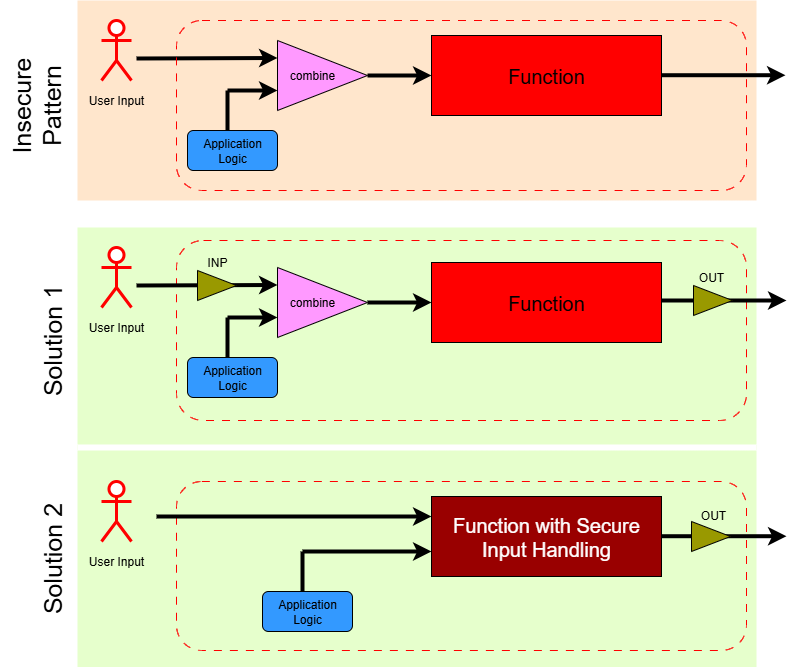

# G7 - Input Handling
{: .no_toc }

## Table of contents
{: .no_toc .text-delta }

1. TOC
{:toc}

---

## Description

An injection vulnerability occurs when the following is given:

1. a malicious user is able to trigger the calling of a function,
2. the users' supplied input data is combined with application logic, and
3. the this input is crafted in such a way that the application behaves in an unintended manner.

The fundamental issue is that the failure to maintain proper separation between code and data can lead to serious security flaws when the data provided by an attacker leads the function to perform unintended operations.
The following image shows a schematic representation of an injection flaw:

  

Note that the function processing the user input has no way of distinguishing between the application logic and the user input, since both are combined (pink triangle) before the function is called.
Injection vulnerabilities can occur both on the server-side and on the client-side.
Examples of functions where injection vulnerabilities can occur include (but are not limited to) SQL queries, operating system command execution functions, LDAP query functions, XML parsers, and HTML rendering in the browser.
Input sources that can serve as injection vectors are very diverse and include (but are not limited to) HTTP parameters, headers, cookies, JSON/XML request bodies, file uploads, environment variables, message queue payloads, and responses from both internal and external web services.

A successful injection attack can result in:

- **Data breach and manipulation**: Unauthorized access to sensitive information and database tampering.
- **Authentication bypass**: Circumventing login mechanisms and access controls.
- **Authorization escalation**: Gaining elevated privileges within the application.
- **Remote code execution**: Running arbitrary commands on the host system (arbitrary code execution).
- **System compromise**: Complete takeover of the affected server or service.
- **Lateral movement**: Using compromised systems as stepping stones to attack other network resources.

The figure above also illustrates two different concepts that can be used to prevent injection vulnerabilities:

1. **Solution 1 - Secure handling of user input** - the goal of this method is to neutralize untrusted input such that the function cannot wrongly interpret the user input in and therefore cannot be tricked to execute wrong or unintended logic. This is typically achieved by means of input validation, input sanitization and input encoding. In the figure above, these techniques are represented by the box with the label "INP".

    - *Input validation* - consists of checking if the input conforms to a strict specification (e.g. template) of what is considered valid input. This can include checks for data type, length, format, and range. The idea is to reject any input that does not conform to the expected format.

    - *Input sanitization* - consists of cleaning the input by removing or escaping characters that could be misinterpreted as code. This is typically done using a whitelist approach, where only known safe characters are allowed, and all other characters are either removed or escaped.

    - *Input encoding* - consists of transforming the input into a safe format that cannot be misinterpreted by the function. This is typically done using context-specific encoding schemes, such as HTML entity encoding for web pages, URL encoding for URLs, and SQL escaping for database queries.

2. **Solution 2 - Use of secure function alternatives** - the goal of this method is, whenever possible, to use functions that are designed to be secure against injection attacks. A pattern to look for in code is when a function requires at least two input parameters, which are used to logically separate application logic from user input. A typical example of a secure function alternative is the usage of prepared statements for database access instead of string concatenation to build SQL queries.

Another additional layer of defense that can be added to avoid injection vulnerabilities is to implement *output encoding*. In the figure above, this technique is represented by the box with the label "OUT". Output encoding consists of transforming data before it is sent to an external system (e.g. web browser, database, etc.) in such a way that it cannot be misinterpreted as code by the receiving system. This is typically done using context-specific encoding schemes, such as HTML entity encoding for web pages, URL encoding for URLs, and SQL escaping for database queries.

## Mitigations

<!-- MUST -->
### 
### 
### 

<!-- SHOULD -->
### 
### 
### 
### 

<!-- COULD -->
### 

## Testing

### 
### 
### 
### 
### 
### 
### 

## Further Information

- [OWASP A05:2025 - Injection](https://owasp.org/Top10/2025/A05_2025-Injection/)

- [OWASP Cheat Sheet Series](https://cheatsheetseries.owasp.org/index.html)

- [OWASP Web Security Testing Guide](https://owasp.org/www-project-web-security-testing-guide/)
